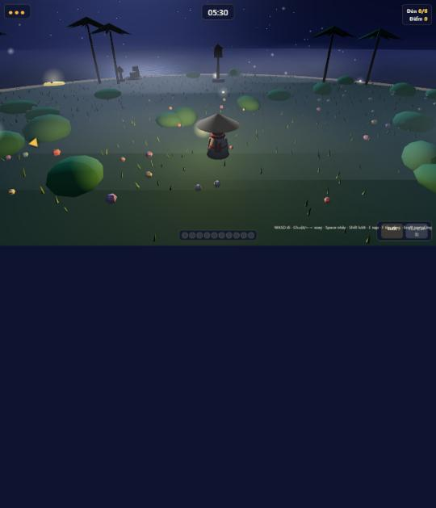

# Đảo Đèn Lồng — v1.0.0

> **Video demo:** đính kèm ở [Release v1.0.0](https://github.com/cuong-sadboi/K5-L3A-DAY12-NguyenTienCuong-2A202603425-AI-SDLC-Dao-Den-Long/releases/tag/v1.0.0) (file `demo.mp4`).



Game 3D góc nhìn thứ ba. Mây, người giữ đèn nhỏ tuổi, gom đom đóm để giữ các Đèn Lồng Lớn sáng tới bình minh trên ba hòn đảo (Đảo Bến, Đảo Cau, Đảo Chuông), né Bóng Mực và Gió Lạc trong sương đen.
Bài lab cá nhân Day 12 AI SDLC — Nguyễn Tiến Cường (2A202603425). Tài liệu lab gốc: [docs/lab/](docs/lab/README.md).

## Yêu cầu hệ thống

- **Node.js ≥ 20.** Chạy được trên macOS, Linux và Windows; CI kiểm trên ubuntu và macOS.
- **Trình duyệt hỗ trợ WebGL2** (Chrome, Edge, Firefox, Safari bản mới).
- **Benchmark** cần một trình duyệt nhân Chromium đã cài sẵn (Chrome, Edge hoặc Chromium). Nếu trình duyệt không nằm ở chỗ quen thuộc, đặt đường dẫn qua biến `BENCH_BROWSER`.

## Cài đặt và chạy (3 lệnh)

```bash
git clone https://github.com/cuong-sadboi/K5-L3A-DAY12-NguyenTienCuong-2A202603425-AI-SDLC-Dao-Den-Long.git && cd K5-L3A-DAY12-NguyenTienCuong-2A202603425-AI-SDLC-Dao-Den-Long
npm ci
npm start       # mở game trong trình duyệt (http://localhost:5173)
```

**Bản phát hành** (không cần cài Node):
1. Tải `dao-den-long-v1.0.0-web.zip` ở Release `v1.0.0` và giải nén.
2. Phục vụ thư mục bằng một máy chủ tĩnh bất kỳ, ví dụ `python3 -m http.server 8080` rồi mở http://localhost:8080. Trình duyệt không cho chạy module từ `file://`, nên không mở trực tiếp file được.
3. Ở bản tĩnh, bảng xếp hạng lưu trong `localStorage` của trình duyệt.

## Điều khiển (đổi phím trong Cài đặt → Đổi phím)

| Phím | Việc |
|---|---|
| W A S D | Đi |
| Chuột | Nhìn quanh kiểu FPS: nhấp vào màn hình để khóa chuột, di chuyển chuột để xoay và nghiêng camera (độ nhạy chỉnh trong Cài đặt) |
| Esc | Thả chuột và mở menu tạm dừng |
| Lăn chuột | Kéo camera gần/xa |
| ← / → | Xoay camera bằng bàn phím |
| Space | Nhảy |
| Shift | Lướt |
| E | Nạp đom đóm vào đèn (đứng gần đèn) |
| F | Tỏa sáng |
| P (hoặc Esc khi chưa khóa chuột) | Tạm dừng (Tiếp tục / Chơi lại Đêm / Cài đặt / Về menu) |
| Enter | Chọn nút chính ở menu và màn kết quả |

## Luật chơi và cách tính điểm (Ticket-02 + Ticket-03 "Đèn cạn dầu")

Số tinh chỉnh nằm ở `tuning` trong [game.contract.json](game.contract.json); các hằng số chuẩn khác và bản đồ nằm ở `STD`, `NIGHTS` trong `src/sim/core.js`.

- **Chuỗi 3 Đêm:** Đảo Bến (5 đèn, 240 s), Đảo Cau (6 đèn, 270 s), Đảo Chuông (7 đèn, 300 s). **Thắng khi tới bình minh còn ít nhất 60% số đèn đang sáng** (3/5, 4/6, 5/7); thắp đủ đèn không kết thúc Đêm. Thắng thì sang Đêm tiếp, thắng Đêm 3 thì gặp Bình Minh. Thua thì chơi lại Đêm đó.
- **Dầu đèn:** đèn sáng có 100 dầu, hao 1/giây, hết dầu thì tắt. Đứng gần đèn đang sáng nhấn E để châm dầu (mỗi đom đóm +10 dầu). Thắp lại đèn đã từng sáng chỉ cần 5 đom đóm. Đèn dầu < 30 nhấp nháy và mất vùng an toàn.
- **Sức chứa:** 10 + 2 × số lần thắp thành công, tối đa 20.
- **Đom đóm:** tự nhặt khi tới gần (≤ 1 m), mang tối đa 10.
- **Đèn:**
  - Đứng trong 2 m quanh đèn chưa sáng, nhấn E để nạp. Cần 10 đom đóm để thắp; đèn nhớ phần đã nạp.
  - Đèn đã sáng tạo vùng an toàn 6 m mà Bóng Mực không vào được.
- **Bóng Mực:**
  - Đuổi khi Mây cách ≤ 12 m, bỏ đuổi khi > 18 m.
  - Lúc lang thang, Bóng Mực tìm đèn yếu (dầu < 30) để hút dầu 5/giây; Mây lại gần trong 6 m thì nó bỏ đèn để đuổi.
  - Chạm thì Mây mất 1 lửa, rơi một nửa số đom đóm đang mang ra xung quanh, và được bất tử 1,5 s.
- **Rơi khỏi đảo:** mất 1 lửa và toàn bộ đom đóm, hồi sinh ở điểm xuất phát sau 1 s. Hết 3 lửa thì thua.
- **Lướt (Shift):** 14 m/s trong 0,2 s, hồi chiêu 1,5 s.
- **Tỏa sáng (F):** tốn 3 đom đóm, làm choáng Bóng Mực trong 5 m trong 2 s và đẩy lùi 4 m; hồi chiêu 3 s.
- **Gió Lạc (Đêm 2, 3):** cướp 3 đom đóm khi Mây mang từ 5 con trở lên. Tỏa sáng trúng nó lúc đang bỏ chạy thì đom đóm bị thả lại.
- **Bùa Gió:** trong 10 s chạy 7,2 m/s và lướt không cần hồi chiêu.
- **Gió mạnh (Đêm 3):** cứ 30 s lại có một cơn gió đẩy Mây trong 5 s.
- **Điểm (Ticket-03):**
  - +5 cho mỗi đom đóm nạp vào đèn (thắp hoặc châm dầu).
  - +100 khi thắp lần đầu, +40 khi thắp lại.
  - +5 cho mỗi Bóng Mực trúng tỏa sáng (+15 nếu nó đang hút dầu).
  - Khi thắng lúc bình minh: mỗi đèn đang sáng +50 + phần nguyên số dầu, mỗi lửa còn lại +50.
  - Tổng điểm là tổng các Đêm đã thắng.
- **Cài đặt "Bảng màu dễ phân biệt"** (Esc → Cài đặt): Bóng Mực viền xanh #00B3FF, cảnh báo màu trắng kèm ⚠; đèn tắt luôn xẹp và rách nên không cần màu để phân biệt.

## Benchmark, soak test và bảng xếp hạng (Ticket-04)

```bash
node scripts/bench.js --seed 42 --duration 30 --out bench.json      # bench_cmd
node --expose-gc src/soak.js --seed 7 --nights 10 --out soak.json   # soak_cmd
node scripts/run.js --export-leaderboard out.json                   # run_cmd + xuất bảng xếp hạng
```

- **Benchmark:**
  - Script phục vụ thư mục `dist/` (tự build nếu chưa có), rồi mở trình duyệt nhân Chromium ở cửa sổ 1280×720 với profile tạm và cờ tắt vsync (`--disable-gpu-vsync --disable-frame-rate-limit`).
  - Trang chạy cảnh chuẩn: Đêm 1, 200 Bóng Mực, 100 đom đóm, L1–L3 sáng, camera bay vòng 15 giây một vòng. Khởi động 3 giây rồi đo đúng `--duration` giây.
  - Hiệu ứng trang trí sáng tạo (sương trôi, đom đóm trang trí) tắt trong cảnh này.
  - `peak_mem_mb` = `null`, vì game chạy trong trình duyệt nhiều tiến trình nên không đo được RSS của riêng nó.
  - Kết quả trên máy tôi (Intel i5-11300H, GPU tích hợp Iris Xe, Windows 11, Chrome 157): avg 163,2 fps, p1_low 58,7 fps, load 1.053 ms. Xem [docs/proof/phase-4/bench.json](docs/proof/phase-4/bench.json).
- **Soak:** 10 Đêm liên tiếp trong cùng một tiến trình, xoay vòng Đêm 1 → 2 → 3. Đêm thứ i (đếm từ 0) dùng seed + i, input ngẫu nhiên theo seed. Kết quả: 0 crash, bộ nhớ 51,4 → 58,2 MB. Xem [docs/proof/phase-4/soak.json](docs/proof/phase-4/soak.json).
- **Bảng xếp hạng:**
  - Sau màn Bình Minh, hoặc khi thua ở bất kỳ Đêm nào, nhập tên 3–12 ký tự (chữ, số, `_`; nhận cả chữ tiếng Việt có dấu) để lưu điểm.
  - Giữ top 10, điểm giảm dần; bằng điểm thì ai đạt trước đứng trên.
  - Khi chạy bằng `npm start`, điểm lưu trên đĩa ở `data/leaderboard.json`; màn "Bảng xếp hạng" mở từ menu chính.

## Dễ tiếp cận

- **Đổi phím** cho mọi hành động, có báo trùng phím và nút "Khôi phục mặc định". Cài đặt được lưu.
- **Phụ đề và báo hình ảnh:** Bóng Mực xuất hiện (kèm mũi tên ở mép màn hình), gió mạnh sắp thổi, 10 giây cuối, đèn sắp hết dầu hoặc đã tắt.
- **Giảm chuyển động:** tắt chớp màn hình khi bị đánh (game không có rung camera).
- **Chữ:** chữ giao diện tối thiểu 18 px ở 1280×720, có tùy chọn chữ lớn ×1,25.
- **Bảng màu dễ phân biệt:** từ Phase 3.

## Chế độ headless (Test Contract v1.3)

```bash
node src/headless.js --seed 1 --night 1 --ticks 600 --out out.jsonl [--scenario s.json] [--inputs i.json] [--snapshot-every 10]
```

- **Khai báo:** `game.contract.json` ở gốc repo: `build_cmd` = `npm ci && npm run build`, `run_cmd` = `node scripts/run.js`, `headless_cmd` = `node src/headless.js`, `bench_cmd` = `node scripts/bench.js`, `soak_cmd` = `node --expose-gc src/soak.js`.
- **Yêu cầu chạy:** headless chỉ cần Node, không cần cửa sổ hay GPU. `--night` nhận 1, 2, 3.
- **Tốc độ:** một Đêm đầy đủ (21.600 tick) chạy khoảng 0,3–0,45 s.
- **Mã thoát:** 0 khi chạy xong; 2 khi file inputs/scenario sai định dạng; 1 cho các lỗi khác.
- **Giả định:** các chỗ ticket chưa quy định được ghi ở [docs/notes/phase-2.md](docs/notes/phase-2.md) (Phase 1: [phase-1.md](docs/notes/phase-1.md)). Ví dụ: `night_start` ghi ở tick 0 sau snapshot đầu; Đêm 3 xuất phát ở (0, 0, −30); quy ước góc điểm = (r cos θ, y, r sin θ).

## Kiểm chứng

- `npm test`: 53 test, gồm contract, luật chơi Phase 1–2 (cập nhật theo luật mới, có ghi chú `Ticket-N:`), tính năng Phase 2, luật dầu đèn Phase 3, bảng xếp hạng, soak và cảnh bench Phase 4.
- Bằng chứng Phase 4: [docs/proof/phase-4/README.md](docs/proof/phase-4/README.md). Retro cả dự án: [docs/notes/retro.md](docs/notes/retro.md).
- `node scripts/verify.js phase-N`: chạy test, các scenario trong `docs/proof/phase-N/scenarios`, kiểm tra tất định và mã thoát.
- Bằng chứng: [Phase 1](docs/proof/phase-1/README.md), [Phase 2](docs/proof/phase-2/README.md), [Phase 3](docs/proof/phase-3/README.md).
- Quyết định thiết kế: [docs/adr/](docs/adr/0001-den-co-dau-va-thang-luc-binh-minh.md). Thay đổi phá vỡ tương thích: [CHANGELOG.md](CHANGELOG.md).
- Tình huống dựng sẵn trong trình duyệt: `/?night=2&seed=1`, `/?demo=near-win`, `/?demo=shade`, `/?night=2&demo=drifter`.

## Sáng tạo của tôi

- **Đèn lồng nhỏ trên nón lá của Mây cho biết số lửa còn lại.** Đèn sáng mạnh khi còn đủ lửa, mờ dần khi mất lửa, và chập chờn khi chỉ còn 1. Phần này chỉ nằm ở giao diện, nên output headless không đổi: test tất định và các scenario vẫn đạt.
- **Lời dẫn của Ông Đăng** ở màn giới thiệu mỗi Đêm, và âm thanh tự tổng hợp bằng WebAudio (không dùng file ngoài).

## Cấu trúc

```text
game.contract.json   Test Contract: lệnh + tuning chuẩn
src/sim/             logic thuần, tất định (dùng chung cho headless và giao diện)
src/headless.js      CLI headless
src/game/            giao diện Three.js (menu, HUD, âm thanh, cài đặt)
tests/               test node:test
scripts/             verify.js (bằng chứng), stop-hook.js (hook)
docs/notes/          yêu cầu, giả định, nhật ký dùng AI
docs/proof/phase-N/  bằng chứng từng phase
CLAUDE.md            hướng dẫn cho agent
.claude/             skill verify, hook Stop, launch.json
.github/workflows/   CI trên ubuntu và macOS
```

## Harness AI

- [CLAUDE.md](CLAUDE.md): lệnh, cấu trúc, quy tắc. Cập nhật qua từng phase.
- Skill [`verify`](.claude/skills/verify/SKILL.md): cách chạy kiểm chứng và lưu bằng chứng cho một phase.
- Hook `Stop` ([.claude/settings.json](.claude/settings.json) + `scripts/stop-hook.js`): chạy `npm test` và chặn agent kết thúc khi test đỏ.
- CI ([.github/workflows/ci.yml](.github/workflows/ci.yml)): `npm test`, chạy headless 3 Đêm hai lần để so tất định, và build. Chạy trên ubuntu và macOS.
- Nhật ký dùng AI: [docs/notes/ai-log.md](docs/notes/ai-log.md).
